# PlantPose: Universal Plant Skeleton Estimation via Tree-constrained Graph Generation

Xinpeng Liu, Hiroaki Santo, Yosuke Toda, Fumio Okura · **IJCV 2026** · [Paper](https://doi.org/10.1007/s11263-026-02882-4)

Official implementation for predicting plant skeleton nodes and edges from images, with training and evaluation for root, grapevine (Guyot), synthetic trees and the general-purpose mix model.

## Download and extract

Download root, synthetic and self-captured data below. Obtain third-party images from their providers or the supplied URLs, following the [source-specific terms](#license-and-acknowledgements).

### Datasets

#### Domain-specific models

| Dataset | Train + val | Test |
| --- | --- | --- |
| root | [12.52 GB](https://drive.google.com/file/d/1RdcegnaBFeGbxR7f3pSuun_4Fi089H8_/view) | [10.9 MB](https://drive.google.com/file/d/1Aoi2DxJq0ocDCTzcR7WrHocYovnvr25V/view) |
| guyot | [Official RGB and annotations](https://zenodo.org/records/7679898) | [Split and conversion code](data_preparation/USAGE.md#guyot) |
| synthetic (L-system) | [2.04 GB](https://drive.google.com/file/d/1fIbvJ_rTX2vl87CAH5HdQ-lMtMjZZ4Nt/view) | [20.4 MB](https://drive.google.com/file/d/1yrrOsMnAzPQHDkkC1VINGjF8z6fnsGkb/view) |

Root uses fixed augmented training/validation images. Guyot requires preparation from the original dataset; its domain-specific split differs from the mix split.

Synthetic Train contains 100,000 images; the default configuration selects the first 40,000. Synthetic Test contains the fixed first 1,000 **validation** images, extracted to `data/synthetic/valid`; download it for training validation too. Preserve the supplied ID order.

#### Mix: in-domain

The mix model trains on six sources and uses their fixed validation/test splits. Counts below are input samples before training repetition; LVD RGB and vein masks are two representations of the same leaves.

| Source | Train | Val | Test | Obtain |
| --- | ---: | ---: | ---: | --- |
| Self-captured plants | 652 | 82 | 83 | [Images + graph labels (424.50 MB)](https://drive.google.com/file/d/1vOiLYVkdK-VKTmxCkXHM3dY6EhskEFcF/view?usp=sharing) |
| Web-sourced plants | 1,320 | 166 | 168 | [URLs + graph labels (2.47 MB)](https://drive.google.com/file/d/12CnufDMQO4OldpVDcrZNh-QK7Tm1g3pi/view?usp=sharing) |
| Guyot | 1,202 | 150 | 151 | [Official dataset](https://zenodo.org/records/7679898) |
| LVD leaf RGB | 1,858 | 232 | 232 | [Request LVD2021 from its authors](https://github.com/LeryLee/vein_segmentation) |
| LVD vein masks | 1,858 | 232 | 232 | Prepare locally from the same LVD2021 data |
| MIPDB maize | 12,992 | 249 | 250 | [Official dataset categories](http://phenomics.agis.org.cn/#/category) |

The web package contains 1,654 graph labels and `sources.csv` with 1,399 source URLs and crop/resize information, including 399 cropped samples; it contains no images. Download images separately and prepare them as described in the included `SOURCE.txt`. Some source URLs may no longer be available.

#### Mix: out-of-domain

These four sets are used only to test mix generalization.

| Dataset | Train / val | Test | Obtain |
| --- | --- | ---: | --- |
| root | — | 782 | [Images and graphs, 156.0 MB](https://drive.google.com/file/d/15DyShn4hYzoOW6in44ScQCuc6bVUoPrG/view) |
| Thickened L-system | — | 500 | [Images and graphs, 10.6 MB](https://drive.google.com/file/d/1OL1Oi-aYzmzFE1BucthoC2z5boSC1EKJ/view) |
| LVD with backgrounds | — | 500 | Obtain LVD, then composite locally using whole-leaf masks and [background URLs (62.8 KB)](https://drive.google.com/file/d/1NdtHX3Q6ebMTl3i1SyEOyO83pywXmXL0/view?usp=sharing) |
| Mtree | — | 500 | [Mtree](https://github.com/MaximeHerpin/modular_tree), [parameter ranges](data_preparation/mtree_parameters.py) and [background URLs (62.2 KB)](https://drive.google.com/file/d/1qcIXvL9R0KqVHfW55icNR5Z1lzpLaBvS/view?usp=sharing) |

The LVD background package contains 626 URLs; the Mtree background package contains 1,408 URLs. Both contain URLs only. Obtain leaf images and masks from LVD's authors.

<details>
<summary><strong>Preparation and augmentation</strong></summary>

See [preparation commands](data_preparation/USAGE.md). Expand a dataset below for an example. Graph overlays are existing labels, not predictions; blue points are nodes and orange lines are edges.

<details>
<summary>Root</summary>

Input image and the supplied root graph.

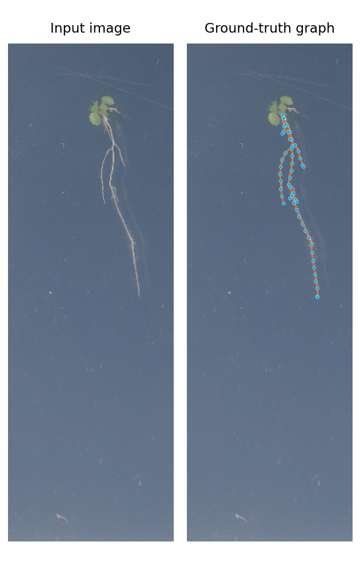

</details>

<details>
<summary>Guyot</summary>

Source: [3D2cut Single Guyot](https://zenodo.org/records/7679898). RGB image and imported annotations; domain-specific and mix splits remain separate.

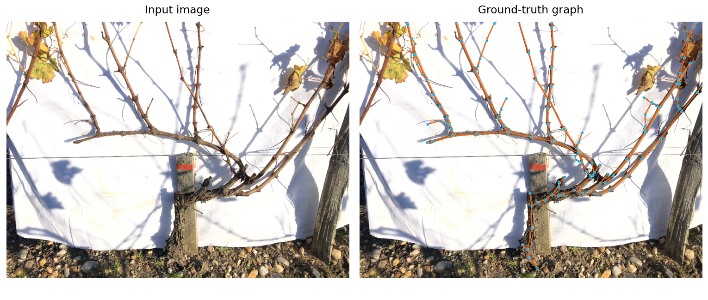

</details>

<details>
<summary>Synthetic (L-system)</summary>

A generated L-system image and its graph, from the supplied validation set.

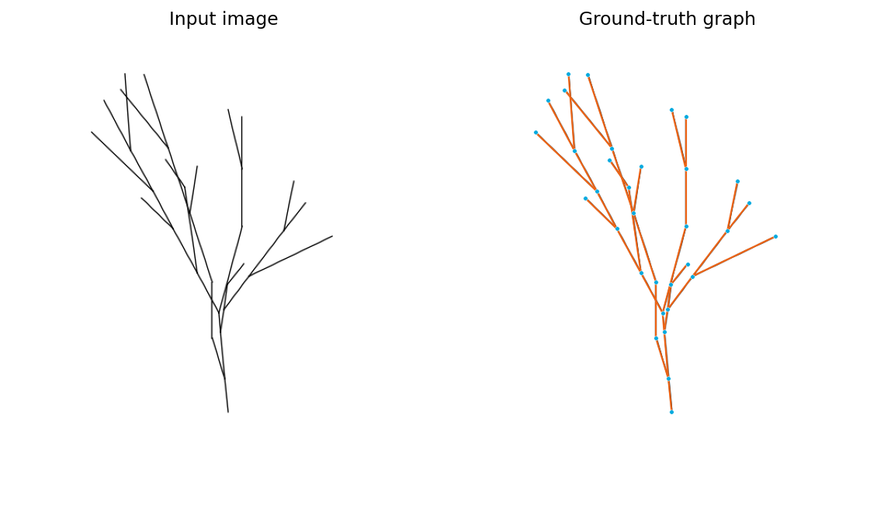

</details>

<details>
<summary>Self-captured plants</summary>

Our photograph and graph annotation, included in the self-captured package.

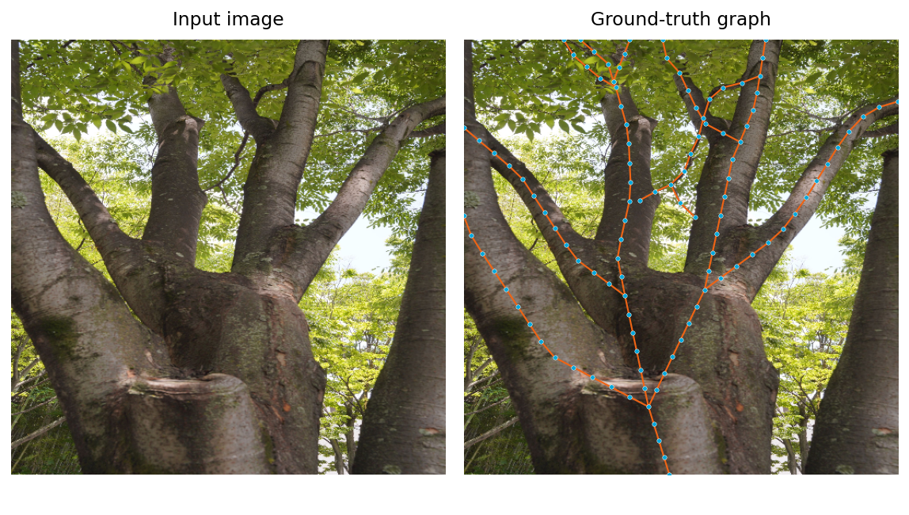

</details>

<details>
<summary>Web-sourced plants</summary>

A [source photograph](https://www.chrisbowers.co.uk/controlpanel/ckfinder/userfiles/images/plum%20tree%20blossom%281%29.jpg) and our graph annotation. The download package contains URLs and labels only.

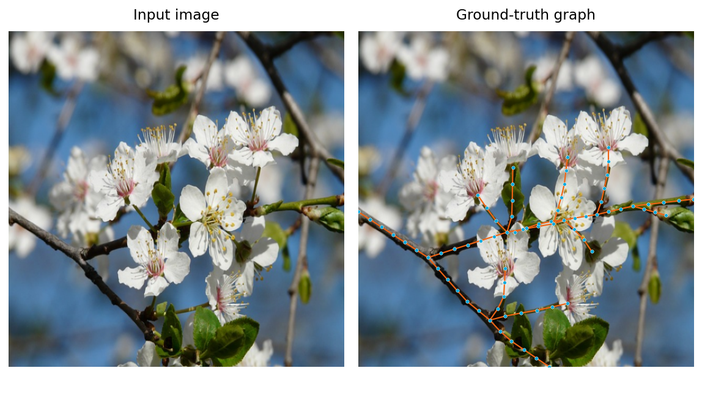

</details>

<details>
<summary>LVD: RGB and vein mask</summary>

Leaf image, vein mask and prepared graph. RGB and masks are separate mix inputs. Source: [LVD2021](https://github.com/LeryLee/vein_segmentation).

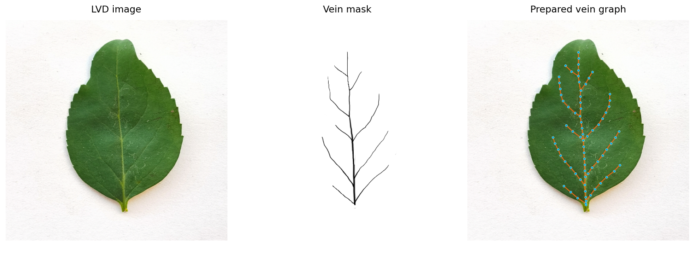

</details>

<details>
<summary>MIPDB maize</summary>

Plant crop, original branch annotations and prepared graph. Source: [MIPDB](http://phenomics.agis.org.cn/#/category).

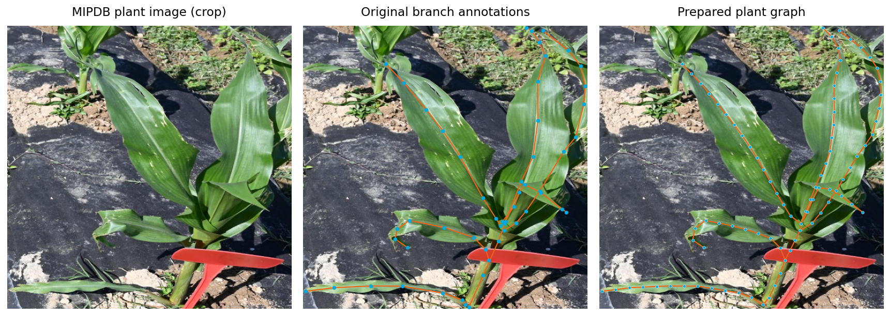

</details>

<details>
<summary>Root (mix out-of-domain)</summary>

A prepared root image and graph from the 782-image held-out set.

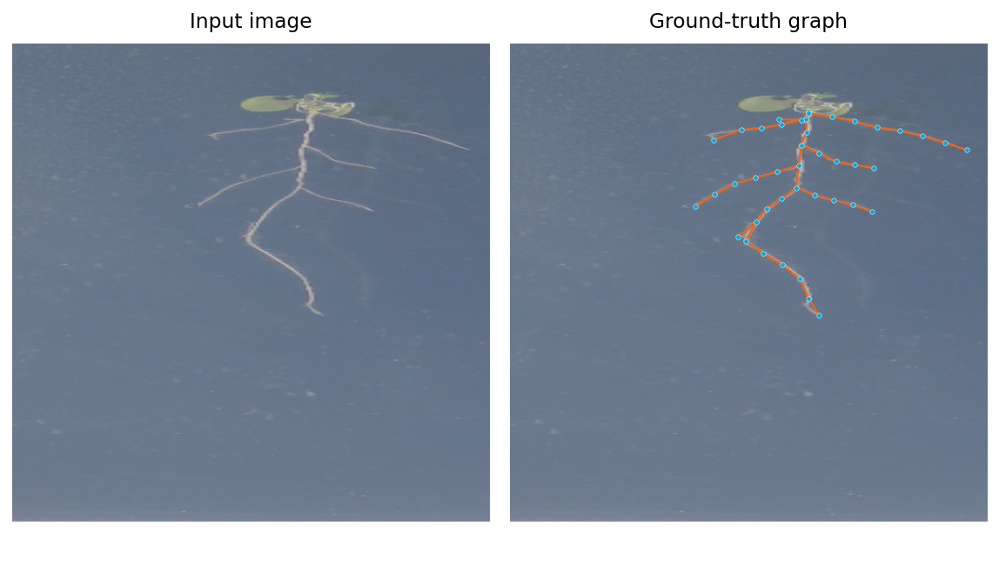

</details>

<details>
<summary>Thickened L-system (mix out-of-domain)</summary>

An image and graph from the fixed 500-image held-out set.

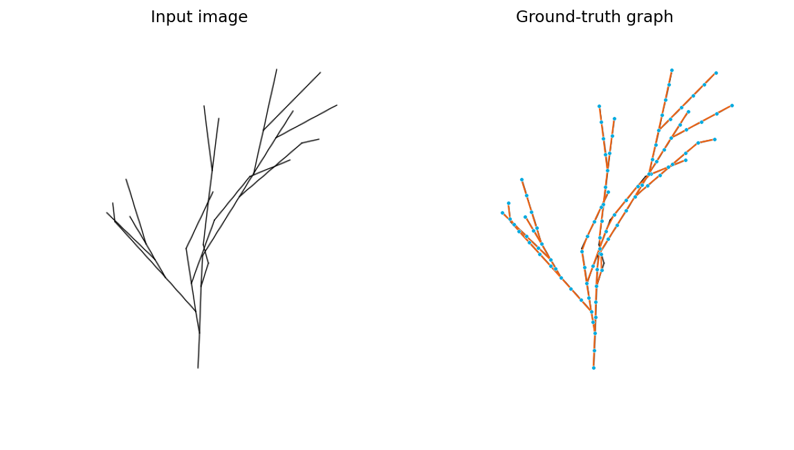

</details>

<details>
<summary>LVD with backgrounds (mix out-of-domain)</summary>

Whole-leaf mask + [URL background](https://www.finegardening.com/app/uploads/fg169la-web-resources/image/FG169LGFG169LA-Adiantu_opt-e1548259478626.jpeg) → composite. The existing leaf graph is transformed with the leaf.

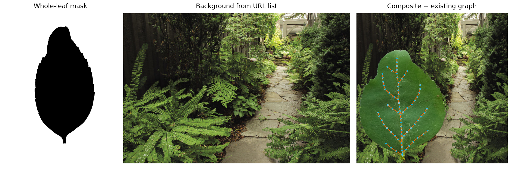

</details>

<details>
<summary>Mtree (mix out-of-domain)</summary>

An illustrative rendered tree and saved graph from the historical 500-image set. [Parameter ranges](data_preparation/mtree_parameters.py) are provided; the snippet does not reproduce this image.

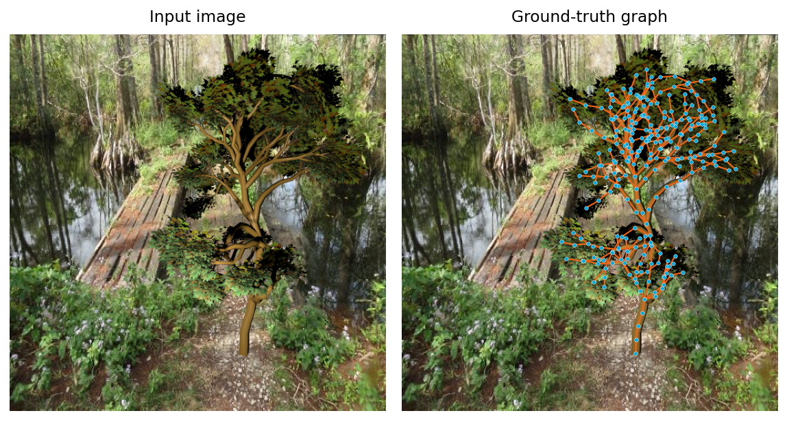

</details>

Image/annotation credit: the original providers, including Jérome Corre / 3D2cut SA, LVD2021 authors and MIPDB contributors. Figures are resized and overlaid for illustration. Third-party images, including web/background images, retain their source terms; publication permission for these local previews is not established by this README.

<details>
<summary>Augmentation settings</summary>

| Training data | Fixed augmentation | Online augmentation |
| --- | --- | --- |
| root | Approx. ±10° rotation, horizontal flip, gamma 0.6–1.4, noise | None |
| guyot | Gamma 0.7–1.3, noise, horizontal flip | Integer rotation ±15° |
| synthetic | Generated images | None |
| mix | Base samples; repetition handled by the loader | Gamma 0.7–1.3, noise, horizontal flip, integer rotation ±15° |

Noise has mean 0 and standard deviation 0.1 in [0,1] image space. Gamma is a power transform. Guyot's fixed augmentation and mix's online photometric step use gamma / noise / gamma+flip / noise+flip / gamma+noise+flip with probabilities 20 / 10 / 56 / 7 / 7%. Root uses separate flip/gamma/noise probabilities of 0.5/0.5/0.3, with a fallback after failed rotation/crop attempts. Online rotations are accepted only when the graph checks pass. Mix applies online augmentation to all six sources, including masks and maize. Validation/test inputs stay fixed.

</details>

</details>

### Checkpoints

Download: [plantpose_checkpoints_minimal_v1.zip](https://drive.google.com/file/d/1RjopOQqxLU24sEgZqxHgxVQgzGkFSfRC/view) (1.64 GB).

Files: `checkpoints/<dataset>_mst.pt` and `checkpoints/<dataset>_unmst.pt`, where `<dataset>` is `root`, `guyot`, `synthetic` or `mix`. MST/UnMST describes **training**; test-time MST is selected separately.

These contain model weights only, for evaluation. Resume training with checkpoints saved by `train.py`.

## Extract location

Extract the downloaded PlantPose packages into the project root, beside `evaluate.py`. Prepare third-party data in the same layout:

```bash
python -m zipfile -e plantpose_root_test_minimal_v1.zip .
python -m zipfile -e plantpose_checkpoints_minimal_v1.zip .
python -m zipfile -e plantpose_mix_camera.zip .
python -m zipfile -e plantpose_mix_world_urls_labels.zip .
python -m zipfile -e plantpose_lvd_background_urls.zip .
python -m zipfile -e plantpose_mtree_background_urls.zip .
```

```text
PlantPose/
├── evaluate.py
├── train.py
├── configs/plantpose.json
├── plantpose/
├── data_preparation/
├── data/
│   ├── root/{train,val_aug,test}/
│   ├── guyot/{train_aug,val_aug,test}/
│   ├── synthetic/{train,valid}/
│   ├── mix/<source>/{train,val,test}/
│   └── mix_heldout/{lsystem,bkg_leaf,root,mtree}/
├── sources/
│   ├── lvd_backgrounds/urls.csv
│   └── mtree_backgrounds/urls.txt
└── checkpoints/{root,guyot,synthetic,mix}_{mst,unmst}.pt
```

Each prepared split contains `rgb/*.png`, `data/*.npz` (nodes and edges), and `ids.json` (sample order). The web package supplies the graphs and IDs; create its `rgb/` inputs from the URLs first. Images use lossless compression; the vein-mask domain also stores its input images under `rgb/`. Braces show alternative directory names.

Mix `<source>` folders are `guyot`, `lvd_leaf_src`, `lvd_syn`, `MIPDB_resample_384`, `toda_camera_resample_384` and `toda_world_resample_384`. All six are required for mix training.

## Quick start

Install PyTorch/torchvision, then `pip install -r requirements.txt`. Tested PyTorch/torchvision: 1.9.1/0.10.1 (evaluation), 1.11/0.12 (Linux training).

### Test

```bash
python evaluate.py --dataset root --data data/root/test --checkpoint checkpoints/root_mst.pt --training-mst --test-mst --output outputs/root_mst --gpu 0
python evaluate.py --dataset synthetic --data data/synthetic/valid --checkpoint checkpoints/synthetic_mst.pt --training-mst --test-mst --output outputs/synthetic_mst --gpu 0
python evaluate.py --dataset mix --data data/mix --domain guyot --checkpoint checkpoints/mix_unmst.pt --no-training-mst --test-mst --output outputs/mix_guyot --gpu 0
```

All settings are in `configs/plantpose.json`; select `root`, `guyot`, `synthetic` or `mix` with `--dataset`. Use `--training-mst` for MST weights or `--no-training-mst` for UnMST weights. UnMST-trained checkpoints support either `--test-mst` or `--no-test-mst`; MST-trained checkpoints require `--test-mst` in this release. Add `--limit 2` for a quick check.

Mix domains: `guyot`, `leaf`, `leaf_mask`, `MIPDB`, `toda_cam`, `toda_world`. Held-out tests use `--data data/mix_heldout/<folder>` with domain/folder pairs `lsystem/lsystem`, `bkg_leaf/bkg_leaf`, `root_ood/root`, `mtree_500/mtree`.

Results: `metrics.json` and `graphs.jsonl`. Use a new output directory for each run.

### Train

Save [ResNet50 weights](https://download.pytorch.org/models/resnet50-0676ba61.pth) as `checkpoints/resnet50-0676ba61.pth`.

```bash
CUDA_VISIBLE_DEVICES=0,1,2,3,4,5,6,7 python -m torch.distributed.run --standalone --nproc_per_node=8 train.py --dataset root --data data/root --backbone-weights checkpoints/resnet50-0676ba61.pth --training-mst --workers 1 --output outputs/train_root_mst
```

Each experiment uses eight GPUs; run experiments one at a time. Replace `root` with `guyot`, `synthetic` or `mix` and update the data/output paths. Use `--no-training-mst` for UnMST.

All four datasets use batch 8 per GPU and 100 epochs by default, configured in `configs/plantpose.json`. Each GPU computes its local loss; DDP averages gradients without scaling the learning rate. Training uses FP32 with TF32 and cuDNN benchmark disabled. Incomplete final batches are dropped. The best checkpoint has the lowest mean validation metric across eight GPUs.

Training saves `<dataset>_<mst|unmst>.pt` (latest) and `<dataset>_<mst|unmst>_best.pt` (best). Resume with, for example, `--resume outputs/train_root_mst/root_mst.pt` instead of `--backbone-weights`, keeping the same code/config, eight GPUs, workers and a new output directory; `--epochs` is the final total.

All eight settings passed an eight-GPU training/resume check (20 updates, then 2 after restart). This verifies functionality, not convergence or exact reproduction of the original runs.

## Citation

```bibtex
@article{liu2026plantpose,
  title   = {{PlantPose}: Universal Plant Skeleton Estimation via Tree-constrained Graph Generation},
  author  = {Liu, Xinpeng and Santo, Hiroaki and Toda, Yosuke and Okura, Fumio},
  journal = {International Journal of Computer Vision},
  year    = {2026},
  doi     = {10.1007/s11263-026-02882-4}
}
```

## License and acknowledgements

Original PlantPose contributions, including our code, documentation, annotations and author-created datasets, are licensed under [CC BY-NC-SA 4.0](LICENSE): **non-commercial use only**, with attribution and ShareAlike. Commercial use is not permitted under this license. This applies only to rights held by the PlantPose authors; third-party material retains its original terms.

| Data source | Terms |
| --- | --- |
| Author-provided data and annotations | CC BY-NC-SA 4.0 for material we are authorized to license, including synthetic and self-captured data; root is shared with the provider's permission. |
| [3D2cut Single Guyot](https://zenodo.org/records/7679898) | CC BY-NC-SA 4.0; also applies to Guyot images in mix. |
| [LVD2021](https://github.com/LeryLee/vein_segmentation) leaf images and masks | The authors provide a [data request form](https://docs.google.com/forms/d/e/1FAIpQLSflrJTabnsFd7KjLpu4yBJkKg2yimDdjrYU3Hmd_gJiKstXxQ/viewform) and request citation. Redistribution permission is not yet confirmed. |
| [MIPDB](http://phenomics.agis.org.cn/) maize images | The official site provides downloads; an explicit dataset redistribution license has not yet been confirmed. |

Obtain LVD2021/MIPDB images, masks and original annotations from their providers; prepare derived inputs locally. Web-sourced plant and background images retain their respective owners' rights. Source URLs and our annotations do not relicense those images.

We thank **Jérome Corre and 3D2cut SA** for the Guyot dataset and **Gentilhomme et al.** for [ViNet (2023)](https://doi.org/10.1016/j.compag.2023.107736), **Li et al.** for [LVD2021 (2022)](https://doi.org/10.1016/j.compag.2022.107352), and **Wang et al.** for [MIPDB (2024)](https://doi.org/10.1101/2024.04.26.589844). Please cite the corresponding dataset papers when using their data. Our processed versions resize or augment images, use project-specific splits, and convert annotations to graph files; LVD masks are skeletonized, and MIPDB images are cropped into single plants. No endorsement by the original providers is implied.

We also thank [RelationFormer](https://github.com/suprosanna/relationformer), [Deformable DETR](https://github.com/fundamentalvision/Deformable-DETR) and [DETR](https://github.com/facebookresearch/detr). Their incorporated code retains [Apache-2.0](LICENSE-APACHE-2.0) and existing copyright notices. This update does not revoke permissions already granted under earlier licenses. Data and modifications are provided without warranties; see the applicable license.
